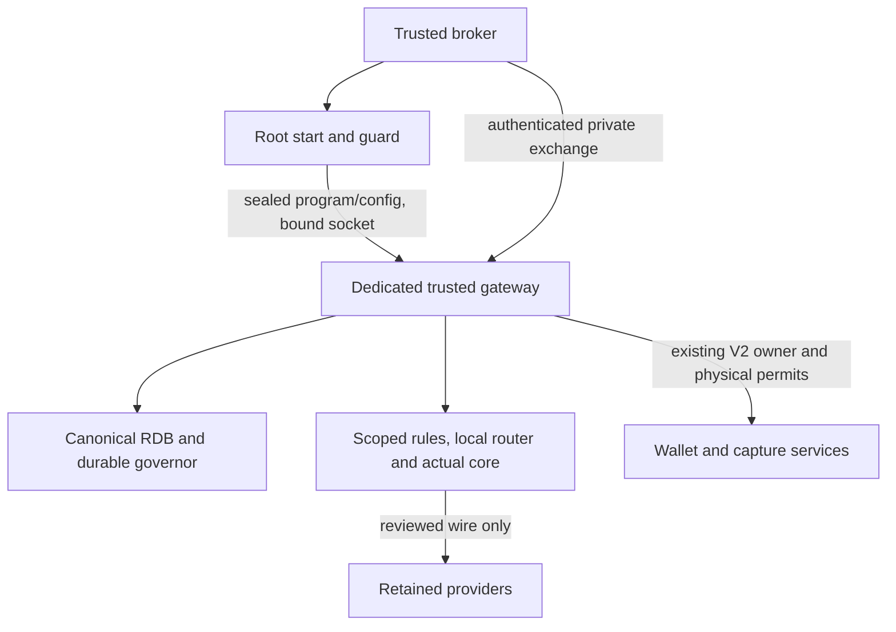
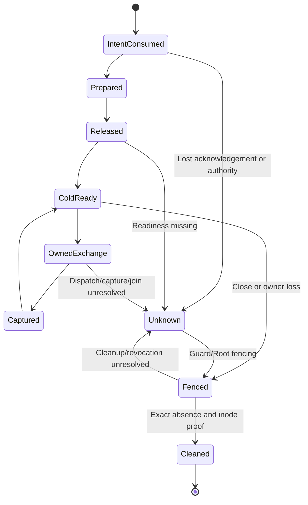
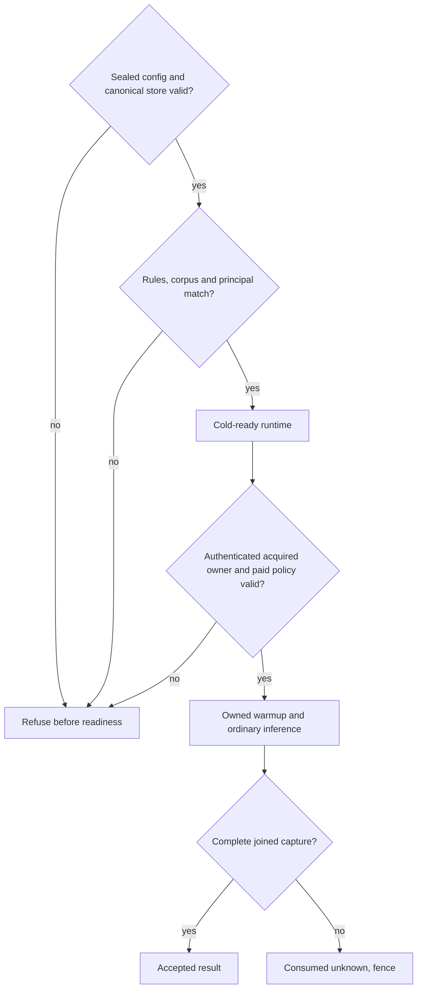
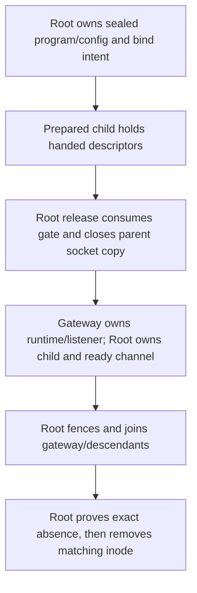

# Protected Production Gateway Bootstrap - Plan

## Goal Capsule

- **Objective:** An operator can exercise the factory's complete protected gateway path on the NUC and distinguish an accepted result from a consumed or unresolved attempt.
- **Means:** Join the published scoped constructors to the retained route, existing owner/capture protocol and owned Root lifecycle (KTD1–KTD6).
- **Authority:** User instructions and the Phase 11A contract govern behavior; this plan governs implementation. The existing wallet, registry, evaluator and approval gates remain authoritative.
- **Execution profile:** Six dependent source milestones, published through the project Git process in the two existing repositories. No deployment or activation accompanies publication. The parent executor verifies, commits and pushes each milestone.
- **Stop conditions:** Missing supported provider bounds or approved principal permissions prevents paid admission, not isolated source integration. Unknown authority, dispatch, capture or cleanup cannot become success or a fresh attempt.

---

## Product Contract

### Summary

Complete the dedicated Bifrost runtime and executable, connect it to the actual broker-authenticated Root launch, and qualify the joined lifecycle with public fixture providers. Keep real paid testing held until the existing charge-bound and authorization gates have evidence.

### Problem Frame

The repository has individually verified wallet, private exchange, listener, launch, scope and construction components. It still lacks the production consumer that joins them. The historical tagged bootstrap selects a different provider route, while the private launcher returns a child to a lifecycle that does not yet own production readiness and cleanup.

### Requirements

**Retained runtime and ownership**

- R1. Use the retained Ollama auto rules with `deepseek-v4-pro:0813` and `deepseek-v4.1-flash:1017`, plus `vercel-classifier` embedding `openai/text-embedding-3-small` and classifier `openai/gpt-6-luna`, including its reviewed Responses fallback.
- R2. Cold construction uses the published DB-only catalog, scoped account/configuration and scoped governance store, with the actual canonical RDB retained for durable state. It produces no provider HTTP or shared policy mutation.
- R3. Kernel broker authentication precedes the existing one-use V2 acquisition. Its context and the reviewed governance principal govern warmup, classification and answer calls through the actual registered handler/core pipeline.
- R4. The first owned exchange supplies any missing embedded semantic generation using `WarmComplexityAuthorized`; no background or lifetime paid grant is created. Every warmup call consumes the same reviewed physical inventory, permanent-task allowance and durable capture as the triggering exchange.
- R5. A successful exchange requires joined streams, the completion witness and acknowledged durable capture. An unknown or unjoined operation consumes its existing identity and prevents further process admission.

**Custody and lifecycle**

- R6. The pinned gateway is trusted code with only reviewed governance/routing builtins, a scoped account, no arbitrary tools/plugins/admin routes/config reload and owned quiet logs. Goose owns tools; external worker/evaluator access to credentials and protected descriptors remains fenced.
- R7. Root hands off a sealed bootstrap configuration, executable and bound non-listening socket to the reviewed gateway child. Post-exec readiness binds the cold runtime to the grant, scope, configuration digest, process identity and socket inode; it does not claim paid warmup has completed.
- R8. The existing authenticated start lifecycle owns the gateway and its descriptors under consumed intent before either gateway or worker launch. Observe/reconcile/close cannot report terminal success while that gateway, descendants, authority revocation or socket cleanup is unresolved.
- R9. Cleanup follows fencing and exact child/descendant absence, then removes only the recorded socket inode under the existing bind lock. Ambiguous resources and earlier failed fixtures remain preserved.

**Live admission and evidence**

- R10. Actual classifier access requires an explicitly reviewed principal/model/key configuration. The current Ollama-only principal continues to deny classifier access; code must not append grants, borrow another principal or set skip flags.
- R11. Preserve $5 per UTC day and $0.75 per permanent task across all six paired attempts, the physical-call ceiling and no refunds/rearm/retry after unknown acknowledgement. Provider-supported bounds must cover every answer/classifier/embedding/fallback/retry/fee path before paid dispatch.
- R12. Source qualification uses disposable public fixtures, actual runtime components and observable negative controls. Candidate remains disabled and benchmark remains 0/120 until the separate live gates permit execution.

### Key Decisions

- **Keep the exact fasthttp derivative with strict integrity.** Governs R6, R12. (session-settled: user-approved — chosen over removing the local replacement: retain the reviewed pre-body admission protections.) This work consumes published `db30a37` without changing that policy.
- **Keep the retained route and existing approval boundaries.** Governs R1, R10–R12. These are requirements carried from `docs/planning/current-status.md`, not an invitation to select cheaper models or alternative providers.

### Acceptance Examples

- AE1. Covers R2, R6, R7. With a valid public disk-backed configuration and explicit classifier fixture grant, the actual runtime reports cold readiness with zero provider HTTP. Invalid CEL or a missing required classifier grant produces refusal and no ready receipt.
- AE2. Covers R3–R5, R11. The first authenticated exchange acquires one V2 owner, warms the reviewed corpus, classifies and answers; each physical callback carries that owner's identity, and success follows durable capture. A dropped physical acknowledgement leaves the same attempt consumed and unusable.
- AE3. Covers R7–R9. After release but before readiness, supervisor loss fences the gateway and a live descendant. A lost acknowledgement never starts a replacement; cleanup succeeds only after exact absence and matching-inode removal.

### Scope Boundaries

This plan completes the production source path and its isolated NUC qualification. It does not deploy it, edit actual shared permissions, perform paid inference or promote a candidate. The already implemented benchmark runner, independent acceptance and promotion machinery are consumed later rather than rebuilt here.

A generic ConfigStore RPC service, a copied authority ledger and a new blanket prohibition on the trusted gateway reading its RDB file were considered and are not built. The current contract relies on pinned trusted gateway code and scoped hydration; replacing that authority or threat model is unnecessary for this integration. Unrelated credential values must still remain absent from SDK inputs, callbacks and logs per R6.

ARM64 runtime qualification and general plugin/tool/admin support are outside this NUC x86-64 path. A route/model change would require a separate user decision.

---

## Planning Contract

### Key Technical Decisions

- KTD1. **Keep canonical durable governance state.** Use the actual protected disk-backed RDB and its existing exclusive normalization-owner lock, unresolved-call restoration and qualified-pricing order (R2, R11). Nil governance stores, fresh per-attempt copies and a parallel ledger do not preserve that authority. Owner contention refuses; source work does not steal or change shared ownership.
- KTD2. **Build one cold runtime with a process-local router.** Hydrate the applicable global and selected unassigned-principal rules, explicitly compile each CEL program, and use the ordinary routing initializer with nil routing configStore plus the explicitly normalized persisted analyzer (R1, R2, R6). This omits shared dimension/registry maintenance without disconnecting governance persistence. Missing or invalid stored state does not fall back to defaults.
- KTD3. **Separate cold readiness from owned semantic readiness.** Runtime setup enables mandatory physical-owner enforcement before SDK construction and wires governed executors without a paid context (R2–R4, R7). The first acquired exchange performs warmup after principal/access resolution and before ordinary inference. Successful generation reuse is limited to the same process and immutable route/corpus.
- KTD4. **Extend the existing descriptor handoff.** Add sealed configuration and bounded post-exec readiness descriptors to the current Root/helper contract (R7, R8). Configuration is selected by trusted Root state, never worker arguments or environment. The standalone command exposes only this private mode and its existing socket arguments.
- KTD5. **Use the existing start and cleanup authority.** Persist consumed intent before gateway side effects and retain all returned child/descriptor ownership in the public authenticated lifecycle (R8, R9). Extend observer/reconciliation evidence rather than adding an agent-selected launch tool or leaving another private helper without a consumer.
- KTD6. **Keep paid-policy activation explicit.** Cold reads do not start reset workers, acquire paid ownership or publish qualified pricing (R2, R10, R11). The qualified admission path performs the existing durable-owner/pricing/freeze sequence only from reviewed configuration, before enabling physical executors. Responses requests use explicit `store:false` before quotation/wire authorization.

The alternatives above are already concrete enough to reject from current source behavior, so no bake-off is needed. No provider or model selection is reopened.

### High-Level Technical Design



```mermaid
sequenceDiagram
  participant R as Root lifecycle
  participant G as Gateway runtime
  participant B as Broker
  participant O as Existing owner/capture
  R->>R: Persist consumed start intent
  R->>G: Prepare, attach and release sealed descriptors
  G-->>R: Bound cold-ready receipt; provider HTTP zero
  B->>G: Authenticated frozen exchange
  G->>O: Acquire existing V2 owner once
  G->>G: Resolve principal; owned warmup; actual inference
  G->>O: Join completion and close durable capture
  G-->>B: Accepted response only after capture acknowledgement
  R->>R: Fence, join and reconcile exact cleanup
```







The same acquisition/capture identity governs the complete request data flow in the sequence diagram. Configuration validation has three outcomes: refuse before readiness, cold-ready with paid policy still ineligible, or ready to accept the already approved owned exchange. A cold-ready receipt alone never overrides R10–R11.

### Implementation Constraints and Assumptions

- The gateway, reviewed builtins and Root are trusted components. Actual UID/DB access provisioning is qualified explicitly; source publication does not grant it.
- The caller supplies protected stable state during construction. The implementation must preserve coherent route/principal/key/corpus bindings and refuse detected drift before readiness; it must not silently replace this precondition with an unsupported snapshot authority.
- The retained semantic store is embedded and process-local. A stored width or registry claim is not a completed generation.
- The reviewed corpus is the actual normalized ordered corpus. The observed 150 stored phrases imply five successful batches, while scalar fallback could require 151 calls and exceed the existing 32-call ceiling. Physical admission remains authoritative in either case.
- Exact internal helper names and the smallest existing handler seam for grant reuse are implementation details. The acceptance evidence must establish one owner/principal path, not rely on callback names.
- No model elevation is configured. Local source patterns and current qualification receipts determine the design; the provider evidence remains an external hold.

### Repository and Source Mapping

Main-repository paths below are relative to `software-factory-goose`. Paths labeled **Bifrost** are relative to the companion `bifrost-local` repository, whose `engine/transport` artifacts are installed into the composed modules by the existing pinned installer. New artifact names may be consolidated when the same actual consumer owns them.

---

## Implementation Units

### U1. Construct the actual retained-route cold runtime

**Goal:** A single dedicated runtime constructor joins the existing account/catalog/governor to the actual rules/router/core and has an owned close path.

**Requirements:** R1, R2, R6, R10; AE1. **Dependencies:** Published `de69191`, `873f565`, `db30a37`.

**Files:** **Bifrost** `engine/transport/factory_gateway_bootstrap.go`, `factory_gateway_bootstrap_test.go`, `factory_gateway_store.go`, `factory_gateway_store_test.go`, `patch_factory_gateway_exchange.py`, `test_patch_factory_gateway_exchange.py`. The existing factory-governance pair is touched only for the narrow cold-lifecycle seam if needed; preserve ordinary active accounting cleanup.

**Approach:**
1. Consume the actual supplied RDB, reviewed principal/credential-reference bindings, approved route/analyzer/corpus identity and caller-owned lifetime; construct the actual DB-only catalog, scoped configuration/account and governor in that order before core workers.
2. Obtain only applicable global and selected unassigned-key rules and normalized persisted analyzer. Populate the ordinary CEL store and explicitly require `GetProgram` success for each rule, because `UpsertRule` logs compilation errors and returns nil.
3. Apply KTD2 and the builtin-only custody settings, validate required model/key permissions without adding any, then construct the actual core and wire owned cleanup. Cold teardown must not flush loaded usage snapshots into canonical state; preserve final flushing after accounted use. Keep paid owner/pricing/physical-executor activation separate per KTD6.
4. Add the actual constructor/test artifacts to the exact-preimage installer; test only the new output paths in reconstruction.

**Execution note:** Start with the actual constructor integration regression in a fresh process, using the established baseline/protected owner-enforcement pattern. Public fixture rows supply explicit classifier permission; a separate fixture omits it.

**Patterns to follow:** `factory_gateway_account_test.go:TestFactoryGatewayAccountCoreInitBoundary`, `factory_gateway_store_test.go`, ordinary `routing.InitFromStore`, `rules.NewLocalStore`/`GetProgram`, historical `qualificationBootstrap.Close` for ordering only.

**Test scenarios:**
- Actual cold construction initializes both retained SDKs, governor/router and approved rules with provider HTTP0 through close; unrelated provider/key/MCP hydration and content logging remain absent.
- Missing/invalid persisted analyzer, wrong route/corpus/key binding, invalid CEL and absent required classifier permission refuse without a ready runtime or provider call.
- Advance applicable budget/rate counters through another canonical writer between cold construction and close; the close must leave those newer values and policy untouched. Retain existing active-accounting final-flush regressions.
- Cancelling construction and failure after each constructed component close/join owned resources and preserve the caller's canonical store; no reset/pricing/ledger activation is inferred from a successful cold object.

**Verification:** Complete relevant installed library, configstore, governance and routing race suites pass; an invalid-CEL negative control fails if the explicit compile check is removed. Installer pins/replay/corrupt-input controls and exact source reconstruction pass. The fresh-process test proves SDK/core integration, not live provider support or executable custody.

### U2. Join acquired ownership, warmup and the real exchange

**Goal:** The existing private exchange uses that runtime for one authenticated principal path from acquisition through durable capture.

**Requirements:** R3–R5, R10, R11; AE2. **Dependencies:** U1.

**Files:** **Bifrost** `engine/transport/factory_gateway_bootstrap.go`, `factory_gateway_exchange.go`, `factory_gateway_exchange_test.go`, `factory_gateway_bootstrap_native_test.go`, `factory_wallet_join_native_test.go`, and the pinned installer/test when artifact hashes change.

**Approach:**
1. Bind the reviewed principal on the authenticated owner-derived context using the actual governance/authentication path. Reuse the resulting grant/access for warmup and ordinary handler execution.
2. Wire the existing governed embedding/chat/Responses executors to the actual core, supply explicit false for Responses storage before quotation, and use the existing immutable wire authorizer/component inventory.
3. Perform KTD3 warmup before the first answer and reuse only a completed matching generation. Every physical call retains the acquired Root and existing durable reservation/capture order.
4. Reuse the registered inference router, stream join, completion witness and `root.Close`; do not replace them with a decoder or direct provider callback in the claimed production constructor.

**Execution note:** Extend the actual wallet/listener rehearsal with the new runtime before claiming an end-to-end join; synthetic authority/provider inputs remain explicitly labeled. The existing main-repository public fixture `clean-room/tests/fixtures/harness_wallet_gateway_join_replay.py` may be extended for the retained component/tariff inventory required by that actual join; do not change production authority.

**Test scenarios:**
- A public loopback provider supplies actual warmup batches, request embedding, classifier fallback and answer through real governor/router/core; every observed callback carries the same owner and reviewed principal, and capture precedes returned success.
- The current Ollama-only permission fixture makes zero classifier callbacks; a distinct explicit-grant fixture permits the positive path without skip flags or borrowed identity.
- Wrong corpus, unsupported scalar fallback beyond remaining inventory, changed immutable call capacity, omitted `store:false`, owner loss, dropped physical acknowledgement and incomplete capture refuse without a fresh owner or inference retry.

**Verification:** Actual joined race/native fixtures pass with measured physical-call count and permanent allowance; relevant guard mutations are rejected. No fixture result establishes hosted billing or real principal approval.

### U3. Add the dedicated executable and cold-ready contract

**Goal:** A Linux command runs the actual dedicated runtime from protected descriptors and exposes only its private listener.

**Requirements:** R2, R6, R7. **Dependencies:** U2.

**Files:** **Bifrost** new `engine/transport/factory_gateway_main.go` and `factory_gateway_main_test.go` artifacts targeting a dedicated `transports/factory-gateway` command; `factory_gateway_command.go`/`factory_gateway_command_test.go` server artifacts; a production existing-store opener and test under `engine/transport` if the tagged-only opener cannot be reused without its historical route; pinned installer/test.

**Approach:**
1. Decode a bounded, duplicate/unknown-field-rejecting sealed bootstrap record containing the existing protected store identity, immutable runtime/review bindings, roles and socket identity. Open only the existing disk-backed RDB without default import, migrations or new authority.
2. Run U1–U2's actual consumer with no environment credential discovery or ordinary public server startup. Retain the caller's reviewed state and existing paid-policy gates.
3. Adopt/activate the already-bound non-listening socket as the gateway UID and emit one bounded cold-ready receipt on the inherited readiness descriptor. Bind it to the immutable launch identities in R7.
4. Own shutdown of listener, core/plugins and any explicitly acquired durable owner; do not unlink Root's pathname. Extend the installer only for the command directory/artifacts it creates, with all checks before writes.

**Test scenarios:**
- The standalone command under distinct UIDs reports cold readiness with HTTP0 and accepts only the reviewed private exchange path.
- Unsealed/changed config, missing existing store, substituted store/socket identity, malformed record and wrong role refuse before readiness; no unrelated file creation or public/admin listener occurs.
- Cancellation and bootstrap failure close all owned descriptors/components; readiness EOF or a malformed acknowledgement remains failure.

**Verification:** Build and run the exact standalone Linux executable from the reconstructed source; its native descriptor test uses actual runtime construction. Source pins, new-directory installation and replay/corruption controls pass.

### U4. Put the executable under the actual Root start lifecycle

**Goal:** The existing broker-authenticated public lifecycle owns the gateway launch, cold readiness and reconciliation.

**Requirements:** R7, R8; AE3. **Dependencies:** U3.

**Files:** `clean-room/crates/execution/harness/linux_supervisor.py`, `linux_gateway_exec.py`, `linux_gateway_userns_bootstrap.py`, `test_linux_supervisor.py`, `test_gateway_peer.py`, both existing harness profile fingerprints, and `clean-room/tests/fixtures/harness_gateway_userns_root_prepare_fixture.py` or its focused joined successor.

**Approach:**
1. Extend the typed Root configuration/source pins for the immutable bootstrap-config and readiness handoff. Update all helper/profile bindings together.
2. Persist the existing consumed start intent before gateway side effects, prepare the sealed descriptors under the bind lock, attach/map/recheck/release once and retain the returned child in the actual `start` lifetime.
3. Verify U3's bounded post-exec receipt against protected preparation/release records and current authority before worker traffic. Preserve existing kernel peer, cgroup, executable, namespace and parent-copy closure checks.
4. Make observe/reconcile/close account for gateway intent, readiness and process lifetime; never report `not_started` after a gateway side effect.

**Test scenarios:**
- Actual broker-to-Root start launches the exact U3 executable under current NUC filters, returns the bound cold-ready receipt and owns child joins.
- Changed config digest, wrong process/start ticks, altered socket/namespace and a same-binary descendant cannot satisfy readiness/peer checks.
- Lost release/readiness acknowledgements and owner loss at prepare/attach/release/readiness remain consumed, fence the owned group and do not launch another gateway or worker.

**Verification:** Existing supervisor/peer suites and the native actual-start fixture pass. Reconciliation mutation removing gateway-intent awareness is rejected. No production source/service configuration is activated.

### U5. Qualify handed-socket cleanup and failure containment

**Goal:** Root can retire a fully qualified handed-off gateway while preserving unknown outcomes.

**Requirements:** R6, R8, R9; AE3. **Dependencies:** U4.

**Files:** `linux_supervisor.py`, `test_linux_supervisor.py`, `test_supervisor_loss.py`, `test_supervisor_start_loss.py`, `test_gateway_custody.py`, relevant existing native gateway/guard fixtures and profile fingerprints when source changes.

**Approach:**
1. Retain the current handed-socket refusal until the complete launch lineage, filter/namespace custody, parent-copy closure and exact cgroup absence are checked by the actual cleanup path.
2. Fence before joining the gateway and descendants; under the bind lock unlink only the durably recorded matching inode, then record terminal cleanup independently of monetary revocation.
3. Keep process, descriptor, namespace, daemon and authority uncertainty explicit. Do not delete or reuse ambiguous earlier fixtures to make a new run pass.

**Test scenarios:**
- Normal close and owner/guard/lease loss fence a live gateway and descendant before matching-inode removal, and the corrected exact resources are independently absent.
- External worker/evaluator access and an outside unprivileged process cannot obtain protected configuration/socket descriptors or join the Root-owned namespace; positive attack controls establish test sensitivity.
- Changed/missing inode evidence, daemon unavailability, unknown Docker outcome, lost revocation acknowledgement and host-restart reconciliation cannot return successful cleanup or rearm the consumed launch.

**Verification:** Complete relevant Python suites and isolated NUC lifecycle controls pass with actual U3 executable and current x86-64 filters. Resource absence is independently checked; unresolved resources remain retained and named.

### U6. Exercise the complete protected path and publish the remaining live holds

**Goal:** An isolated NUC rehearsal uses the actual entrypoints and produces one joined admission/capture/settlement/cleanup record.

**Requirements:** R1–R12. **Dependencies:** U5.

**Files:** Existing `clean-room/tests/fixtures/harness_wallet_custody_replay.py` and actual joined gateway fixture, their relevant harness tests, `docs/planning/current-status.md`, and a new verification MD/JSON record.

**Approach:** Join the real wallet, Root public lifecycle, broker, actual dedicated executable and retained pipeline using public loopback providers and independently checked cleanup. Prepare a precise classifier principal/model/key authorization proposal for review without applying it. Record which supported provider-bound and provisioning/permission receipts remain necessary for live admission; consume the existing benchmark contracts later.

**Test scenarios:**
- One owned public-fixture conversation crosses the actual executable/launch/handler/governance/routing/warmup/capture path, settles once and retires only exact owned resources.
- A wrong broker, missing classifier permission, insufficient permanent allowance and unknown provider/capture outcome remain denied or consumed across restart.
- The real deployment configuration remains ineligible when required provider/permission evidence is absent, even after all synthetic qualification succeeds.

**Verification:** Publish exact source/executable/configuration hashes, complete commands and terminal receipts, limits of each fixture, resolved reviews and remaining live holds. Update current status from those observations rather than declaring Phase 11A complete.

---

## Verification Contract

| Scope | Checks | Required evidence |
|---|---|---|
| Bifrost installation | Python installer unittest module, Ruff, gofmt, diff checks and exact-preimage reconstruction | Corrupt/replay/hardlink controls refuse before writes; resulting source manifest identifies only intended changes |
| Cold runtime | Installed relevant lib/configstore/governance/routing race suites with readonly offline modules | Actual constructor HTTP0 through close, explicit invalid-CEL/principal controls |
| Owned pipeline | Installed server/factory race groups and actual wallet/private-listener native rehearsal | Same acquired owner/principal at every physical call; bounded corpus calls; completed capture before response |
| Executable/Root | Exact Linux build plus supervisor, peer, start/loss and custody tests | Sealed config, bound cold-ready receipt, consumed intent and actual child ownership |
| Cleanup | Native owner/guard/lease/outage/daemon/restart controls | Fence, exact descendant/process absence, matching inode cleanup or preserved unknown |
| Publication | Project Git hygiene, simplification and completed code review per milestone | Named-path commits, exact remote SHA, sanitized MD/JSON receipts and no source-only activation |

Use the established toolchain `/home/bo/sfactory-gateway-responses-reviewed-7ud3GY/toolchain/bin` and private module/build/temp cache `/home/bo/sfactory-dependency-restore-1rofjr1v`. Go qualification uses `-mod=readonly -p=2 -race -count=1` with `GOPROXY=off`, `GOSUMDB=off`, `GOAUTH=off`, `GOENV=off`, `GOTOOLCHAIN=local` and bounded timeouts. Run the applicable complete package suites once after the final change; repeat only for new failures or changed code. Native privileged fixtures use only owned disposable resources and public provider inputs.

## Definition of Done

Each unit has its actual consumer, passing specified positive/negative evidence, exact installer/source identity where applicable, resolved actionable review findings and a coherent pushed commit. Unused experimental implementation code is removed from the delivered diff; failed runtime evidence, ledgers and ambiguous resources remain preserved.

The source integration is complete when the actual Root-started executable satisfies U6 and all custody/cleanup assertions. Paid NUC readiness additionally requires the approved authorization/provisioning configuration and supported affordable all-path provider bounds. The frozen 120-attempt benchmark and Phase 11A acceptance remain separate unfinished requirements after this plan's source completion.

## Sources and Research

- `docs/planning/current-status.md` and `docs/planning/clean-room/phase-11a-plan.md` own the retained route, acceptance and live holds.
- `docs/planning/clean-room/verification/2026-11-03-scoped-gateway-config.md`, `2026-11-03-scoped-governance-init.md`, `2026-11-03-fasthttp-integrity.md`, `2026-11-03-owned-warmup-integration-audit.md` and `2026-11-03-retained-classifier-authorization.md` establish the current construction/warmup boundaries.
- `docs/planning/clean-room/verification/2026-11-03-provider-envelope-recheck.md` records the current provider hold; advertised budgets and successful metadata responses are not hard paid admission proofs.
- Bifrost `engine/transport/factory_gateway_exchange.go`, `factory_gateway_wire.go`, `factory_gateway_account.go`, `factory_gateway_store.go` and historical `engine/qualification/server_qualification_bootstrap.go` show the integration seams. The historical constructor is an ownership/order reference only, not the retained production route.
- `clean-room/crates/execution/harness/linux_supervisor.py`, `linux_gateway_exec.py` and `linux_gateway_userns_bootstrap.py` own launch lineage, descriptor filtering and current cleanup refusal.
- Machine-local source references: companion checkout `/var/folders/3b/9571c77j0078bs3mpjrqcxj80000gn/T/sfactory-remaining-gateway-publication-04afte_6/integration` at `db30a37`; composed source `/var/folders/3b/9571c77j0078bs3mpjrqcxj80000gn/T/sfactory-fasthttp-integrity-installed-a7fi230x/source` at manifest `cae83fbc685d56fc17c4992e42939f038cae80d32cfee740430a4e2617c9dc1d`. These are best-effort local evidence while their temporary directories survive. Missing local copies are not blockers; published source and this plan's requirements govern disagreements. Key composed references are `plugins/routing/main.go:147`, `plugins/routing/rules/store.go:57`, `governance/normalization_ledger.go:63` and `governance/normalization_pricing.go:19`.
